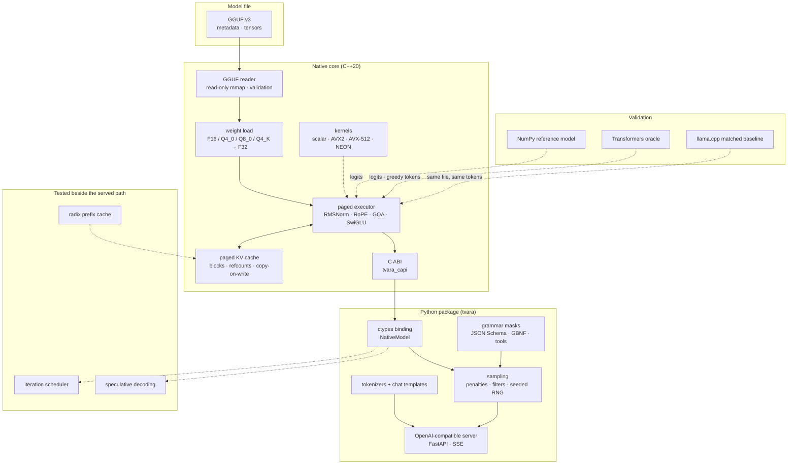
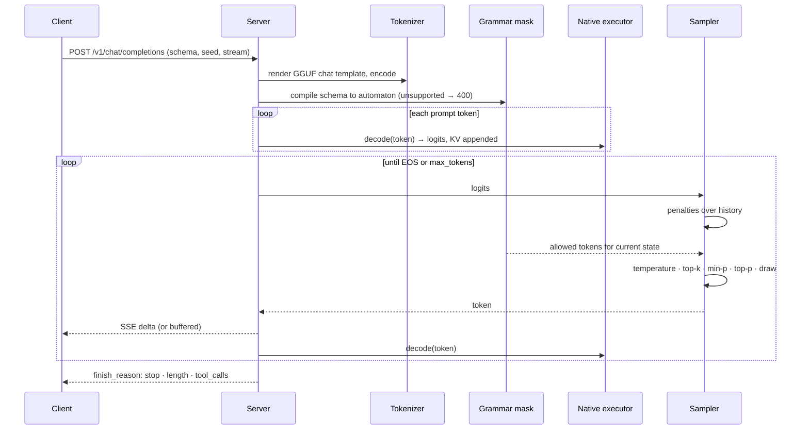

# Tvara

**A CPU-only inference engine for small language models, built from scratch — and measured honestly against the references it replaces.**

[](.github/workflows/)
[](CMakeLists.txt)
[](pyproject.toml)
[](CMakePresets.json)
[](docs/release-notes.md)
[](LICENSE)

Tvara reads a GGUF file, runs a Llama-family transformer in C++20 on the CPU, and serves
the result through an OpenAI-compatible API. It includes streaming, chat templates,
JSON-schema output, and tool calls. Every layer is checked against an independent
reference first. A NumPy model and the Hugging Face Transformers oracle check the
numbers, and llama.cpp provides a matched speed baseline. Each result is recorded with
the machine and conditions it was measured on.

> Asked for `{"city", "days", "indoor"}` under a strict JSON schema, a model with
> *random weights* still answers `{"city":"Paris","indoor":false,"days":6}`. The grammar
> mask removes every token that could break the schema before sampling, so the output
> is valid JSON whatever the weights say.

---

## Contents

| Section | |
|---|---|
| [What it does](#what-it-does) | The capability surface, by area |
| [Architecture](#architecture) | How the pieces fit |
| [How a request runs](#how-a-request-runs) | Tokenize, decode, mask, sample, stream |
| [Quick start](#quick-start) | From a clean checkout to a running demo |
| [Project status](#project-status) | 18 phases, 268 of 270 tasks |
| [Results](#results) | Read from `bench/results/`, never typed by hand |
| [Design decisions](#design-decisions) | The tradeoffs, and why |
| [Repository layout](#repository-layout) | Where things live |
| [Documentation](#documentation) | Which file answers which question |
| [Team](#team) | Who built it |

---

## What it does

| Area | Capabilities |
|---|---|
| **Model loading** | Bounds-checked GGUF v3 reader over a read-only memory map; F32, F16, Q4_0, Q8_0 and Q4_K tensors validated by name and shape; architecture metadata mapped to a Llama configuration |
| **Executor** | Llama-family forward pass in C++20: RMSNorm, split or interleaved RoPE, grouped-query attention, SwiGLU, tied or untied output heads; per-token decode with KV appended only after every layer succeeds |
| **Kernels** | Scalar reference kernels plus runtime-dispatched AVX2 Q8_0 / Q4_0 / Q4_K dot products, opt-in AVX-512 and NEON Q8_0, vectorized norm / RoPE / SwiGLU, a persistent thread pool with a spin-then-sleep barrier |
| **KV cache** | Paged blocks with reference counts, copy-on-write, truncation for rollback, and fused paged attention with online softmax |
| **Prefix reuse** | Radix tree over token sequences with edge splitting, pinned nodes, LRU leaf eviction and KV block release |
| **Tokenizers** | Byte-level BPE with ranked merges and Unicode regex pre-tokenization, SentencePiece unigram with byte fallback, split-UTF-8 streaming, GGUF chat templates in a sandboxed Jinja environment |
| **Sampling** | Greedy, temperature, top-k, top-p, min-p, repetition / frequency / presence penalties, seeded and reproducible |
| **Constrained output** | GBNF grammars and a strict JSON Schema subset compiled to a pushdown automaton; token masks from a vocabulary byte trie with a state cache; tool calls as `{name, arguments}` constraints |
| **Scheduling** | Iteration-level continuous batching with chunked prefill, KV-aware admission, preemption and resumption |
| **Speculation** | Exact draft-model and prompt-lookup speculative sampling with residual resampling, adaptive draft length, grammar-aware proposals and KV rollback |
| **Server** | `/v1/completions`, `/v1/chat/completions`, `/v1/models`, `/health`, `/ready`, SSE streaming, explicit errors for unsupported requests |
| **Evaluation** | NumPy reference model, Transformers oracle, matched llama.cpp baseline, STREAM bandwidth, load generator, compliance checks — all writing JSON to `bench/results/` |

---

## Architecture

The C++ core owns tensors, kernels, the executor and the KV cache, and exposes them
through a small C ABI. Python owns everything stateful around a request: tokenization,
templates, sampling, grammar masks, scheduling, speculation and HTTP.



Dashed edges are validation or components that are tested on their own but not yet
wired into the HTTP path. The details, including state ownership, locking and error
propagation, are in [docs/architecture.md](docs/architecture.md).

---

## How a request runs



The mask runs before the sampling filters, so filters never bring back a token the
grammar rejected. EOS is allowed only once the grammar accepts and no UTF-8 bytes are
pending ([docs/sampling.md](docs/sampling.md)).

---

## Quick start

```bash
# 1 — environment (Windows paths shown; use .venv/bin/ on Linux and macOS)
python -m venv .venv
.venv/Scripts/python.exe -m pip install -e ".[dev,server]"

# 2 — build and test the native core (omit -G on Linux and macOS)
.venv/Scripts/cmake.exe --preset release -G "MinGW Makefiles"
.venv/Scripts/cmake.exe --build --preset release
.venv/Scripts/ctest.exe --preset release
.venv/Scripts/python.exe -m pytest -q

# 3 — end-to-end demo: builds a fixture, starts the server, drives every endpoint twice
.venv/Scripts/python.exe tools/run_demo.py

# 4 — serve your own model
.venv/Scripts/python.exe -m tvara.server --model path/to/model.gguf --tokenizer path/to/tokenizer.json
```

> On Windows, build with MinGW-w64 GCC and put its `bin` directory first on `PATH`
> before `ctest`. The Transformers and tokenizer oracle tests need the `oracle` extra and
> the checksum-pinned checkpoints listed in `tests/fixtures/`. See
> [docs/development.md](docs/development.md) and [docs/release-notes.md](docs/release-notes.md).

---

## Project status

**v0.1.0 is released.** 268 of the 270 roadmap tasks are complete with tests or
recorded evidence. The other two are blocked on hardware: T248 benchmarks AVX-512
against AVX2, and T250 validates ARM NEON output. Their code, harnesses and CI jobs
exist, but no machine with AVX-512 or ARM has been available.

```mermaid
gantt
    title Delivery — 18 phases
    dateFormat X
    axisFormat %s
    section Foundation
    Phase 1 · scope and documentation        :done, 0, 1
    Phase 2 · toolchain and repository       :done, 1, 2
    Phase 3 · reference model and harness    :done, 2, 3
    section Core
    Phase 4 · GGUF loading                   :done, 3, 4
    Phase 5 · quantization and kernels       :done, 4, 5
    Phase 6 · tokenizers                     :done, 5, 6
    Phase 7 · executor and sampling          :done, 6, 7
    Phase 8 · SIMD and threading             :done, 7, 8
    Phase 9 · paged KV cache                 :done, 8, 9
    section Serving
    Phase 10 · grammar automaton             :done, 9, 10
    Phase 11 · server and bindings           :done, 10, 11
    Phase 12 · prefill and attention         :done, 11, 12
    Phase 13 · radix prefix reuse            :done, 12, 13
    Phase 14 · continuous batching           :done, 13, 14
    Phase 15 · grammar masks and API         :done, 14, 15
    Phase 16 · speculative decoding          :done, 15, 16
    section Stretch and release
    Phase 17 · variants and portability      :active, 16, 17
    Phase 18 · evaluation and release        :done, 17, 18
```



| Phase | Scope | Status |
|---|---|:---:|
| 1 | Purpose, architecture proposal, correctness and metric goals, MIT license | ✅ |
| 2 | C++20 core and ctypes decision, CMake presets, warnings and sanitizers, CI | ✅ |
| 3 | NumPy RMSNorm, RoPE, GQA, SwiGLU and full forward pass; oracle logits and tolerances | ✅ |
| 4 | Bounds-checked GGUF reader, memory mapping, tensor validation, malformed-file tests | ✅ |
| 5 | F16, Q8_0, Q4_0 and Q4_K dequantization; scalar dot products and matmul | ✅ |
| 6 | Byte-level BPE, SentencePiece, special tokens, split UTF-8, token-ID oracle checks | ✅ |
| 7 | Embedding through final projection, prefill and decode, sampling filters and penalties | ✅ |
| 8 | CPU feature detection, AVX2 kernels, thread pool, row partitioning, barrier | ✅ |
| 9 | Paged KV blocks, reference counts, copy-on-write, truncation, exhaustion handling | ✅ |
| 10 | GBNF parsing, pushdown automaton, JSON Schema compilation | ✅ |
| 11 | Python bindings, completions and chat contracts, SSE, cancellation, errors | ✅ |
| 12 | Blocked prefill, online-softmax and fused paged attention, long-context error | ✅ |
| 13 | Radix tree lookup, insertion, splitting, pinning, LRU eviction | ✅ |
| 14 | Request lifecycle, iteration batching, chunked prefill, admission, preemption | ✅ |
| 15 | Vocabulary trie masks, mask cache, UTF-8 state, response formats, templates, tools | ✅ |
| 16 | Draft proposals, verification, acceptance and residuals, rollback, prompt lookup | ✅ |
| 17 | Qwen2 and Gemma references, AVX-512 and NEON kernels, quantized KV, MoE, tree speculation, WASM | ⚠️ 2 blocked |
| 18 | Pinned fixtures, STREAM, llama.cpp baseline, regressions, measurements, docs, release | ✅ |

---

## Results

Every number below is read from `bench/results/` by `tools/render_performance_tables.py`;
a test fails if it is out of date.

<!-- results:start (generated by tools/render_performance_tables.py; do not edit) -->
All models are seeded random-weight fixtures: these numbers describe the engine's mechanics, not pretrained-model quality or speed. Host A is a 4-thread Intel Family 6 Model 61 machine; host B a 32-thread Intel Family 6 Model 183 machine; results are not comparable across hosts. Full tables and limits: [docs/performance.md](docs/performance.md).

| Measurement | Result | Host | Source |
|---|---|---|---|
| Correctness | max logit error 8.9e-08 vs. the Transformers oracle; greedy tokens match | A | [final-regression](bench/results/final-regression.json) |
| Matched baseline (F32, 1 thread) | decode 8,010 vs. 4,369 tok/s, prefill 8,214 vs. 12,177 tok/s (Tvara vs. llama.cpp, tiny fixture) | A | [matched-baseline](bench/results/matched-baseline.json) |
| Memory bandwidth | STREAM triad 8.0 GB/s, single thread | A | [memory-bandwidth](bench/results/memory-bandwidth.json) |
| Prefix reuse | 75% of prompt tokens reused, 3.55x faster prefill, identical outputs | A | [prefix-cache-traces](bench/results/prefix-cache-traces.json) |
| Scheduler | TTFT p50 1.3 ms at concurrency 1, 19.9 ms at 16 | A | [scheduler-concurrency](bench/results/scheduler-concurrency.json) |
| Speculative decoding | 0.15-0.60x (slower in all 40 rows; serial verification) | B | [speculative-speedups](bench/results/speculative-speedups.json) |
| Structured output | 235/235 finished responses schema-valid, 17/17 truncated ones valid prefixes, 8/8 unsupported schemas rejected | B | [structured-output-compliance](bench/results/structured-output-compliance.json) |
| End-to-end demo | 5/5 checks pass; transcripts identical across 2 server processes | B | [demo-transcript](bench/results/demo-transcript.json) |
<!-- results:end -->

## Design decisions

**Reference first, optimize second.** Each component got an independent reference
before it got a fast path. The NumPy model checks the C++ executor, the Transformers
oracle checks the NumPy model, scalar kernels check SIMD kernels, and unfused attention
checks fused attention. An optimization counts only when its output matches and its
speedup is measured ([docs/optimizations.md](docs/optimizations.md)).

**A C++ core and a Python shell, meeting at a C ABI.** Kernels, the executor and the
KV cache are C++20, because their cost per token matters. Tokenization, grammars,
sampling and serving are Python, because they change most often and are easiest to
check. The decisions are recorded in [docs/decisions/](docs/decisions/).

**Numbers are generated, never typed.** Benchmarks write JSON with the time, host and
conditions they were measured under. `docs/performance.md` and the table above are
rendered from those files, and the test suite fails if they drift.

**Exact speculation, even when it loses.** Speculative decoding uses the exact
acceptance and residual rules, so its output distribution matches the target's. With
serial verification it is slower than plain decoding in every measured case, and the
docs say so instead of tuning a benchmark until it looks good.

**Unsupported means rejected.** JSON Schema keywords outside the supported subset, an
unknown architecture, scaled RoPE or a malformed GGUF fail with an explicit error. They
are never silently ignored.

**No weights in the repository.** Benchmarks use seeded random-weight fixtures with
pinned checksums. Oracle checkpoints and tokenizers are downloaded locally and verified
by SHA-256. Every result states that it is not evidence of pretrained-model quality.

---

## Repository layout

```
.
├── core/
│   ├── include/tvara/  GGUF reader, quantization, kernels, executor, KV, radix, C ABI (header-only C++20)
│   └── src/            C ABI library, model check tool, version
├── python/tvara/       bindings, tokenizers, sampling, grammar, schema, masks, scheduler,
│                       speculation, server; reference/ holds the NumPy model and oracle
├── tests/
│   ├── core/           C++ tests: tensors, GGUF, quantization, SIMD, threads, KV, radix, prefill
│   ├── python/         pytest suite: reference, oracle, tokenizers, server, grammar, speculation
│   └── fixtures/       pinned oracle logits, greedy tokens and model manifests
├── bench/              C++ benchmarks, unmodified STREAM source, results/ as JSON
├── tools/              fixture generators, benchmark and evaluation runners, demo, release review
├── docs/               design notes, decisions, protocols, results and release notes
└── .github/            CI workflows and the pull request template
```

---

## Documentation

| Question | File |
|---|---|
| *How is it built, and why?* | [docs/architecture.md](docs/architecture.md), [docs/design.md](docs/design.md), [docs/decisions/](docs/decisions/) |
| *How do the kernels and sampling work?* | [docs/kernels.md](docs/kernels.md), [docs/sampling.md](docs/sampling.md), [docs/quantization.md](docs/quantization.md) |
| *How do I build, test and serve it?* | [docs/development.md](docs/development.md), [docs/api.md](docs/api.md), [docs/native-bindings.md](docs/native-bindings.md) |
| *Show me it working end to end* | [docs/demo.md](docs/demo.md) |
| *What are the results?* | [docs/performance.md](docs/performance.md), [docs/benchmarks.md](docs/benchmarks.md) |
| *How is correctness checked?* | [docs/correctness.md](docs/correctness.md), [docs/reference-validation.md](docs/reference-validation.md) |
| *What does structured output support?* | [docs/structured-output.md](docs/structured-output.md), [docs/grammar-syntax.md](docs/grammar-syntax.md) |
| *What is blocked or limited?* | [docs/release-notes.md](docs/release-notes.md), [docs/avx512-validation.md](docs/avx512-validation.md), [docs/arm-validation.md](docs/arm-validation.md) |
| *What ships, under which licenses?* | [docs/release-review.md](docs/release-review.md), [docs/licensing.md](docs/licensing.md) |

---

## Team

| Member | Focus |
|---|---|
| **Guru R Bharadwaj** | Design, native core, kernels, Python package, server, evaluation, docs and release |

Changes follow [docs/development.md](docs/development.md) and the
[pull request template](.github/pull_request_template.md). A change records its
validation commands and environment, and a performance change records its hardware,
model checksum and baseline.

---

## License

[MIT](LICENSE). Model weights, datasets, STREAM and other third-party components keep
their own licenses ([docs/release-review.md](docs/release-review.md)).
