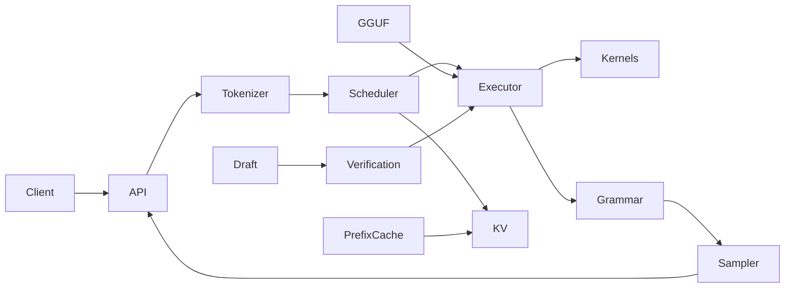

# Architecture proposal

This is the repository's tracked design baseline. Components below are planned
unless the task list links to implementation and validation evidence.

Requests enter a serving adapter, which tokenizes input and submits a sequence to
the scheduler. The executor reads tensor views from a read-only GGUF mapping and
performs prefill or decode using portable kernels. SIMD dispatch replaces kernels
without changing model semantics. Per-sequence KV block tables belong to the cache;
the scheduler chooses work but does not manipulate tensor storage directly.

Logits pass through penalties, optional grammar masking, and sampling. Speculative
decoding verifies proposals through the same executor and must roll back rejected
KV positions. Prefix reuse retains references to shared blocks; mutation requires
copy-on-write. Cancellation releases all sequence-owned references.

Dependencies: reference numerical checks precede core optimization; validated
single-sequence decode precedes cache sharing, batching, and speculation. Serving
protocol tests can use a deterministic test backend while real-model execution is
still under development. A test backend is never advertised as model inference.
